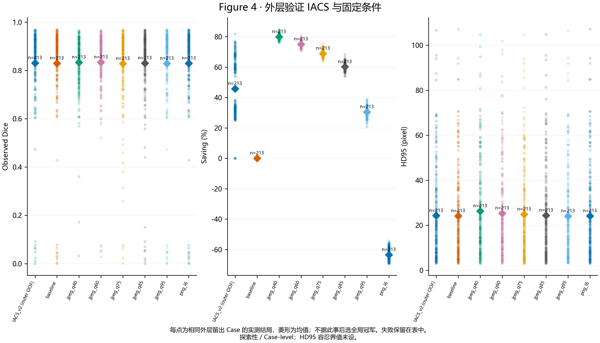

# SAM 医学图像压缩与 IACS v2 科研记录

本仓库保存 Windows 本地 SAM 项目的代码、论文规划、实验记录、匿名 Case 级数值、冻结策略和科研汇总图。最新结果为 **2026-11-08，BUS-BRA development，IACS v2 探索性验证**。这是一份研究记录，尚无临床非劣效性或安全性结论。

## 当前证据

- 213 个开发 Case，每 Case 一图；Case 尚未核实为独立患者。baseline、JPEG Q95/85/75/60/40、PNG_L6 共 1491/1491 条成功记录。
- 外层 5 折、内层 3 折 Case 分组交叉验证；三个算法家族与内层选择的 IACS 共 852 条 OOF 决策。5 个外层训练折均选择 Logistic 风险模型，训练内最佳固定质量均为 Q85。
- IACS OOF 平均 Dice 0.831155、HD95 24.218902 pixel、ASSD 7.008939 pixel、文件节省 45.8273%；Q85 对应 0.829850、24.364441 pixel、7.166885 pixel、60.1747%。
- IACS−Q85 的节省率差为 **−14.347365 个百分点**，95%CI [−16.844224, −11.785482]；Dice 差 +0.001304，95%CI [−0.006032, 0.009636]；HD95 差 −0.145539 pixel，95%CI [−0.666013, 0.351730]。
- 候选 Dice 下降 >0.02：IACS 20/213，Q85 32/213。IACS 用较大文件换取较少的候选下降，**未证明质量和体积同时优于 Q85**。连续变化预测较弱，风险概率校准仍有限。

Dice 0.02 仅为敏感性分析候选值，未经临床论证。HD95 容忍界值未设，缺少可靠逐图像素间距，HD95/ASSD 均报告 pixel。置信区间为固定 OOF 记录的 2000 次 Case bootstrap，未涵盖重新拟合及模型选择的不确定性。提示为原图坐标内参考轮廓框扩展 10% 的机制实验，不能替代真实自动定位；BrEaST 和原 851 留出集未用于本轮 v2 调参或评价。

## 阅读顺序

1. [论文规划](PAPER_PLAN.md)、[实验记录](EXPERIMENT_LOG.md)。
2. [IACS v2 SCI 结果](reports/iacs_v2/research_reports/IACS_SCI_RESULTS.md)、同目录的特征、压缩、验证、统计和模型卡报告。
3. [复现说明](REPRODUCIBILITY.md)、[数据说明](DATA_AVAILABILITY.md)、[发布范围](PUBLICATION_SCOPE.md)。
4. `experiments/iacs_v2/dev_20261108_123935/`：原字节匿名特征、1491 条候选数据、任务结果、折分、策略、统计和测试日志。大 JSON 使用无损 gzip，源 SHA-256 见清单。
5. `reports/iacs_v2/publication_v2/`：8 张汇总图（PNG/SVG/PDF）、CSV、XLSX、完整报告 JSON 与离线 HTML。HTML 解压后可本地打开，均只含匿名数值。
6. `pilot/` 与 `workbench/`：保留两套实现及测试。`docs/archive/`、`experiments/archive/` 是较早版本，不能与本轮合并为独立样本。

## 原始资料保护

仓库不含患者原图、参考轮廓、逐例预测掩膜、压缩图像、病例图像面板、临床身份表、身份映射、HMAC 密钥、SAM 权重、虚拟环境或原始 SQLite。原始影像和权重仍保存在本地。匿名记录中的 artifact 字符串只供追溯，对应像素文件没有上传。病例级数值仍是研究资料，不因伪名化而证明完全不存在再识别风险。

最新研究报告优先于历史说明。旧工作台与 pilot 的边界指标定义不同，不能混合汇总。源码原有版权归各权利人，见 [第三方说明](THIRD_PARTY_NOTICES.md)。

## BrEaST 冻结跨数据集验证（2026-11-08）

已完成 IACS v2 冻结策略在 BrEaST 上的跨数据集验证。252 个主病灶 Case 完成 Original、固定 JPEG Q85、IACS 三组共 756 次 SAM 推理；另 4 个正常 Case 仅纳入传输效率分析。IACS−Q85 的 Dice 均值差为 −0.000650（95%CI −0.004171 至 0.002549，Holm P=1.000）；HD95_mm 差 −0.014211（95%CI −0.068559 至 0.039367，P=1.000）；ASSD_mm 差 +0.001783（95%CI −0.013362 至 0.017464，P=1.000）；文件节省率差 −4.158662 个百分点（95%CI −5.659051 至 −2.729497，P=8.62×10⁻¹⁰）。本轮不支持 IACS 总体优于固定 Q85，也不构成正式非劣效或临床安全结论。

详细报告：[BrEaST 验证报告](reports/breast_cross_dataset/BREAST_CROSS_DATASET_VALIDATION_REPORT.md)、[数据审计](reports/breast_cross_dataset/BREAST_DATASET_AUDIT.md)、[测试报告](reports/breast_cross_dataset/BREAST_TEST_REPORT.md)、[冻结报告](reports/breast_cross_dataset/PREINFERENCE_FREEZE_REPORT.md)、[统计分析计划](reports/breast_cross_dataset/STATISTICAL_ANALYSIS_PLAN.md)、[讨论草稿](reports/breast_cross_dataset/SCI_DISCUSSION_DRAFT.md)。
